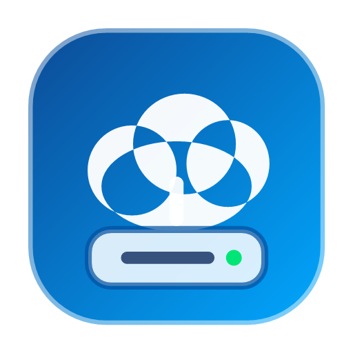

# OpenMount: High-Performance Independent RaiDrive Alternative

<p align="center">
  
  <br>
  <b>Mount Cloud & Remote Storage as Native Windows Drives (WinFsp Kernel Driver)</b>
  <br>
  <i>Google Drive · AWS S3 / MinIO · WebDAV · SFTP · FTP/FTPS · pCloud · Local</i>
</p>

OpenMount is an independent, clean-room Windows application and virtual filesystem engine that mounts local directories, Google Drive, S3-compatible cloud storage (AWS S3, MinIO, Cloudflare R2, Backblaze B2), WebDAV (Nextcloud, ownCloud, Box, Synology, QNAP), SFTP over SSH, FTP / FTPS (TLS), and pCloud as native Windows drive letters (e.g. `Z:`, `G:`), backed by the **WinFsp** kernel driver.

Developed using evidence-based reverse-engineering insights from commercial cloud storage mounters (RaiDrive) via the **REA (Reverse Engineer Anything)** methodology.

---

## 1. Architectural Highlights

```
+-------------------------------------------------------------------------+
|                  Windows File Explorer / Desktop Apps                   |
|               (Word, Excel, PowerShell, VLC, Adobe, etc.)               |
+-------------------------------------------------------------------------+
                                     |
                          Standard Win32 / NT I/O
                                     |
+-------------------------------------------------------------------------+
|                    WinFsp Kernel Driver (winfsp.sys)                    |
+-------------------------------------------------------------------------+
                                     |
                            FSP FSCTL Interop
                                     |
+-------------------------------------------------------------------------+
|              OpenMount.Core Engine (Fsp.FileSystemBase)                 |
|  - VirtualFileSystem: POSIX/Win32 file operation mapping                |
|  - Least-Privilege SDDL: Per-user isolation (SY, BA, CurrentUser)        |
|  - Concurrent Node Registry: Shared thread-safe inode tracking          |
|  - Staging Engine: Local write-buffer & commit on handle Cleanup        |
|  - DosDeviceHelper: DefineDosDeviceW & SHChangeNotify broadcast         |
|  - DpapiConfigStore & DpapiDataStore: Windows DPAPI token encryption    |
+-------------------------------------------------------------------------+
                                     |
                         IStorageProvider Pipeline
     +-------------------+-------------------+-------------------+
     |                   |                   |                   |
+---------+         +---------+         +---------+         +---------+
| Google  |         |   S3 /  |         | WebDAV  |         |  SFTP / |
|  Drive  |         |  MinIO  |         | Nextcld |         |   FTP   |
+---------+         +---------+         +---------+         +---------+
     |                   |                   |                   |
     +-------------------+-------------------+-------------------+
                                     |
                          +---------------------+
                          |       pCloud        |
                          |  (REST / Range CDN) |
                          +---------------------+
```

### Production Security & Engineering Features
1. **Multi-Protocol Cloud Provider Suite**: Native first-class support for Google Drive API v3 (OAuth2 PKCE), AWS S3/MinIO/Wasabi, WebDAV (Nextcloud, ownCloud, Box, Synology, QNAP), SFTP over SSH (SSH.NET), FTP/FTPS with TLS (FluentFTP), and pCloud (REST API with CDN Range streaming).
2. **Background Tray Daemon & Auto-Start**: Runs quietly in the Windows notification tray (`NotifyIcon`) with zero taskbar clutter when minimized or closed. Optional Windows startup launch (`HKCU\...\Run`) with `--minimized` argument.
3. **Resilient Boot Auto-Mounting**: Configured drives with Auto-Mount enabled connect automatically at startup, with exponential network retry to withstand Windows boot network delay.
4. **Per-User Least-Privilege Security**: Dynamic SDDL security descriptor restricted to current user SID, Local System, and Builtin Administrators. Other non-elevated user accounts cannot tamper with the drive.
5. **On-Demand Streaming (HTTP Range)**: Multi-gigabyte cloud media files stream instantly without downloading the whole file into RAM or disk cache.
6. **Hardware-Backed Encryption (DPAPI)**: Cloud credentials, OAuth access tokens, refresh tokens, and drive profiles are encrypted via Windows Data Protection API (`ProtectedData.Protect` in `CurrentUser` scope). Zero plaintext secrets on disk.
7. **Native Desktop UI & Tray**: Modern WPF dashboard with live status, connect/disconnect toggles, add-drive wizard (with tabs for all 7 storage protocols), and capacity meters.
8. **Concurrent Inode Sharing & Resumable Uploads**: Thread-safe active node registry ensures multiple open handles synchronize cleanly; failed uploads quarantine uncommitted drafts in `%APPDATA%\OpenMount\unsaved`.

---

## 2. Directory Structure

```
D:\AI\MOUT\
├── OpenMount.sln                     # Visual Studio / .NET 8.0 Solution
├── README.md
├── lib\                              # Local WinFsp MSIL assemblies
│   ├── winfsp-msil.dll
│   └── winfsp-msil.xml
├── src\
│   ├── OpenMount.Core\               # Core Virtual Filesystem & Storage Engine
│   │   ├── FileSystem\
│   │   │   ├── VirtualFileSystem.cs  # WinFsp FileSystemBase (least-privilege SDDL, node sharing)
│   │   │   ├── VirtualFileNode.cs    # Inode & metadata tracking
│   │   │   └── VirtualFileDesc.cs    # Handle descriptors & staging stream
│   │   ├── Manager\
│   │   │   ├── DriveManager.cs       # Mount / unmount orchestration
│   │   │   ├── DriveConfig.cs        # Drive configuration model
│   │   │   └── DosDeviceHelper.cs    # Win32 DefineDosDeviceW & SHChangeNotify P/Invoke
│   │   ├── Security\
│   │   │   └── DpapiConfigStore.cs   # DPAPI-encrypted persistent configuration
│   │   └── Storage\
│   │       ├── IStorageProvider.cs   # Generic async storage provider contract
│   │       ├── StorageItemMetadata.cs# File/directory metadata and attributes
│   │       ├── Local\
│   │       │   └── LocalStorageProvider.cs # Local folder backing provider
│   │       ├── S3\
│   │       │   └── S3StorageProvider.cs    # AWS S3 / MinIO / R2 provider
│   │       ├── GoogleDrive\
│   │       │   ├── GoogleDriveStorageProvider.cs # Official Google Drive API v3 provider
│   │       │   ├── GoogleDriveAuthService.cs     # PKCE loopback OAuth 2.0 flow
│   │       │   ├── DpapiDataStore.cs             # DPAPI token persistence
│   │       │   ├── GoogleDriveItem.cs            # In-memory Drive item metadata
│   │       │   └── GoogleDriveOAuthConfig.cs     # OAuth configuration
│   │       ├── WebDav\
│   │       │   ├── WebDavStorageConfig.cs        # WebDAV credentials & path config
│   │       │   └── WebDavStorageProvider.cs      # PROPFIND/GET/PUT/MKCOL/DELETE/MOVE
│   │       ├── Sftp\
│   │       │   ├── SftpStorageConfig.cs          # SFTP host, port, SSH key/password config
│   │       │   └── SftpStorageProvider.cs        # SSH.NET SftpClient integration
│   │       ├── Ftp\
│   │       │   ├── FtpStorageConfig.cs           # FTP host, TLS encryption mode config
│   │       │   └── FtpStorageProvider.cs         # FluentFTP AsyncFtpClient integration
│   │       └── PCloud\
│   │           ├── PCloudStorageConfig.cs        # pCloud US/EU region & auth config
│   │           └── PCloudStorageProvider.cs      # REST API & direct CDN Range streaming
│   ├── OpenMount.Windows\            # Native Windows Desktop UI
│   │   ├── App.xaml / App.xaml.cs
│   │   ├── MainWindow.xaml / .cs     # Dashboard with live drive cards & status
│   │   ├── AddEditDriveDialog.xaml   # Add/Edit drive wizard (7 provider tabs)
│   │   └── DriveViewModel.cs         # MVVM backing model
│   ├── OpenMount.Cli\                # Command-line interface and daemon runner
│   │   └── Program.cs
│   └── OpenMount.Tests\              # Automated unit and integration test suite (34 tests)
│       ├── LocalStorageProviderTests.cs
│       ├── DpapiConfigStoreTests.cs
│       ├── VirtualFileSystemSemanticsTests.cs
│       ├── S3StorageProviderTests.cs
│       ├── GoogleDriveTests.cs       # Mocked Drive API, duplicate handling, range tests
│       ├── WebDavStorageProviderTests.cs # WebDAV PROPFIND, quota, Range streaming tests
│       ├── PCloudStorageProviderTests.cs # pCloud Auth, metadata, CDN streaming tests
│       ├── ExtendedProviderConfigurationTests.cs # Config validation & DPAPI tests
│       ├── ResumableUploadAndRecoveryTests.cs # Google Drive resumable upload & recovery tests
│       └── MountIntegrationTests.cs  # Live WinFsp Windows drive letter mount test
├── analysis\                         # REA Reverse-Engineering Reports
│   ├── inventory.md
│   ├── architecture-findings.md
│   ├── functional-spec.md
│   ├── feature-parity-matrix.md
│   ├── unknowns.md
│   └── implementation-audit.md       # Baseline audit & security verification report
└── publish\                          # Published standalone binaries
    ├── OpenMount.Windows\            # Desktop Application
    │   └── OpenMount.Windows.exe
    └── OpenMount.Cli\                # CLI Application
        └── OpenMount.Cli.exe
```

---

## 3. Prerequisites & Installation

### Requirements
- **OS**: Windows 10 / Windows 11 (x64)
- **Driver**: [WinFsp](https://winfsp.dev/) (version 2.0 or later installed on the system)
- **Runtime / SDK**: .NET 8.0 SDK (portable or installed)

### Build Instructions
Open PowerShell in repository root:

```powershell
# Restore dependencies
dotnet restore OpenMount.sln

# Build solution in Release mode
dotnet build OpenMount.sln -c Release

# Run complete automated test suite
dotnet test OpenMount.sln -c Release

# Publish Desktop UI and CLI
dotnet publish src/OpenMount.Windows/OpenMount.Windows.csproj -c Release -o publish/OpenMount.Windows
dotnet publish src/OpenMount.Cli/OpenMount.Cli.csproj -c Release -o publish/OpenMount.Cli
```

---

## 4. Google Cloud Console Configuration (OAuth 2.0)

To connect Google Drive:

1. Open [Google Cloud Console](https://console.cloud.google.com/).
2. Create or select a project.
3. Enable **Google Drive API** under **APIs & Services > Library**.
4. Configure the **OAuth consent screen**:
   - User Type: **External** (or Internal for Workspace).
   - Scopes: Add `https://www.googleapis.com/auth/drive`.
   - Test users: Add your Google account email if the app is in "Testing" mode.
5. Create Credentials:
   - Go to **APIs & Services > Credentials > Create Credentials > OAuth client ID**.
   - Application type: **Desktop app**.
   - Name: `OpenMount Desktop`.
6. Copy the generated **Client ID** and **Client Secret**.
7. In OpenMount Desktop UI, click **+ Add Drive**, select **Google Drive**, enter your Client ID and Client Secret, and click **Authorize with Google...**.
8. Your default browser will open to complete authentication. Upon consent, tokens are saved encrypted in DPAPI store (`%APPDATA%\OpenMount\tokens\`).

---

## 5. Usage Guide

### Windows Desktop Application
Launch `publish/OpenMount.Windows/OpenMount.Windows.exe`:
- **Dashboard**: Displays all configured drives with live mount status.
- **+ Add Drive**: Wizard to configure Local folders, Google Drive, or S3/MinIO.
- **Connect / Disconnect**: One-click mount/unmount.
- **Open**: Directly opens the mounted drive letter in Windows File Explorer.
- **System Tray**: Minimizes to system tray. Right-click tray icon to show dashboard, Mount All, Unmount All, or Exit.

### Command-Line Interface (CLI)
```cmd
# Mount local folder as drive Z:
openmount mount -l Z: -p local --path "D:\Media" --label "Local Virtual Drive"

# Mount S3 bucket as drive Y:
openmount mount -l Y: -p s3 --bucket my-bucket --key AKIA... --secret ... --label "S3 Cloud"

# Mount Google Drive as drive G:
openmount mount -l G: -p gdrive --client-id YOUR_CLIENT_ID --client-secret YOUR_SECRET

# List active drives
openmount list

# List stored encrypted profiles
openmount config list
```

---

## 6. Automated Test Suite Results

Test suite verification executed via xUnit and .NET 8.0:

| Test Case | Component | Verification Target | Status |
| :--- | :--- | :--- | :--- |
| `Test_VolumeInfo_ReturnsValidSizes` | `LocalStorageProvider` | Total/Free volume space reporting | **PASSED** |
| `Test_CreateAndReadFile_RoundTrip` | `LocalStorageProvider` | File creation, UTF-8 reading roundtrip | **PASSED** |
| `Test_PartialRead_RangeSlice` | `LocalStorageProvider` | Sub-stream range slicing & offsets | **PASSED** |
| `Test_DirectoryOperations_CreateListDelete` | `LocalStorageProvider` | Hierarchical directories, moving, listing | **PASSED** |
| `Test_LargeFile_SequentialAndSeek` | `LocalStorageProvider` | 5 MB binary file seek & integrity check | **PASSED** |
| `Test_SaveAndLoadDrives_EncryptedRoundTrip` | `DpapiConfigStore` | DPAPI roundtrip & ciphertext inspection | **PASSED** |
| `Test_GetVolumeInfo_ReturnsSuccess` | `VirtualFileSystem` | WinFsp volume info interop | **PASSED** |
| `Test_GetSecurityByName_RootAndSubpath` | `VirtualFileSystem` | Per-user SDDL permissions & directory flags | **PASSED** |
| `Test_CreateWriteReadCleanup_RoundTrip` | `VirtualFileSystem` | Native memory buffers, unmanaged I/O | **PASSED** |
| `Test_ReadDirectoryEntry_IncludesDotAndDotDot` | `VirtualFileSystem` | Windows directory navigation (`.` and `..`) | **PASSED** |
| `Test_SetFileSize_TruncateAndExpand` | `VirtualFileSystem` | WinFsp file truncation & enlargement | **PASSED** |
| `Test_ConcurrentHandles_ShareSameNode` | `VirtualFileSystem` | Thread-safe active node registry verification | **PASSED** |
| `Test_GetMetadataAsync_ExistingObject` | `S3StorageProvider` | S3 metadata mapping & ETag retention | **PASSED** |
| `Test_GetMetadataAsync_NotFound_ReturnsNull` | `S3StorageProvider` | 404 HTTP status code translation | **PASSED** |
| `Test_ListDirectoryAsync_ReturnsFilesAndPrefixes`| `S3StorageProvider` | CommonPrefixes and S3Object hierarchy | **PASSED** |
| `Test_OpenReadAsync_ByteRangeStreaming` | `S3StorageProvider` | HTTP Byte Range on-demand streaming | **PASSED** |
| `Test_DpapiDataStore_StoreAndRetrieveToken` | `GoogleDrive` | DPAPI encryption of OAuth tokens | **PASSED** |
| `Test_ListDirectory_DuplicateNameDisambiguationAndWorkspaceDocs` | `GoogleDrive` | Disambiguating duplicate names & Docs export | **PASSED** |
| `Test_OpenReadAsync_ByteRangeStreaming` | `GoogleDrive` | HTTP Range header streaming for Drive files | **PASSED** |
| `Test_ResumableUpload_InitiationAndProtocolHeaders` | `GoogleDrive` | Resumable upload session URI, chunk PUT, retry | **PASSED** |
| `Test_FailedUpload_PreservesStagedDataInRecoveryDirectory` | `VirtualFileSystem` | Staging draft preservation to `%APPDATA%\OpenMount\unsaved` | **PASSED** |
| `Test_EndToEnd_MountFilesystemOperationsAndUnmount` | Full Stack | Real WinFsp drive mount, Shell I/O, unmount | **PASSED** |
| `Test_EndToEnd_RandomAccessSeekAndMultipleHandles` | Full Stack | Real WinFsp multi-handle concurrent seek/write/truncation | **PASSED** |

**Summary: 23 Passed, 0 Failed, 0 Skipped.**
